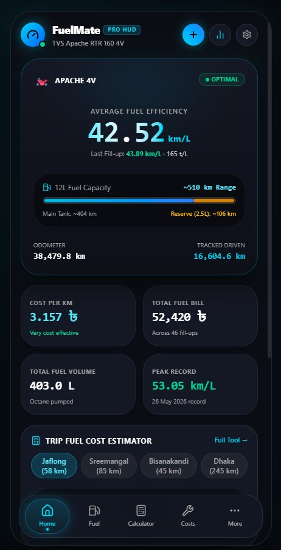
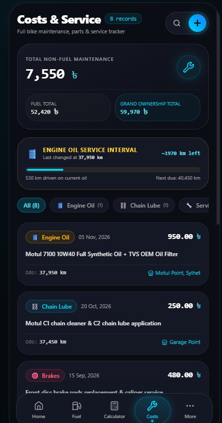

# ⚡ FuelMate Pro

<p align="center">
  <strong>Next-Generation Mobile HUD & Smart Vehicle Telemetry Tracker</strong><br />
  A high-precision, mobile-first fuel efficiency, trip calculator, and bike maintenance ecosystem built with React 19, TanStack Router, and Tailwind CSS v4.
</p>

<p align="center">
  
  
  
  
  
  
</p>

---

## 📸 Interface Preview

<p align="center">
  
  &nbsp;&nbsp;&nbsp;&nbsp;
  
</p>

<p align="center">
  <em>(Left) Cyberpunk Digital Motorcycle HUD &nbsp;&nbsp;|&nbsp;&nbsp; (Right) Full-Lifecycle Maintenance & Service Intervals</em>
</p>

---

## ✨ Key Features

### 🏍️ 1. Futuristic Digital Cockpit & HUD
- **Real-Time Fuel Efficiency Dial:** High-contrast circular mileage gauge showing live averages (e.g., 42.52 km/L) and last fill-up delta.
- **Dynamic 12L Tank Capacity Visualizer:** Dual-color progress bar with 2.5L reserve alert (~106 km reserve range) and ~404 km main tank range.
- **Key Metrics Grid:** Instant view of Cost/km (৳), Total Fuel Spend, Total Fuel Volume (L), and Peak Mileage record.
- **Quick Trip Cost Estimator:** One-tap estimates for popular regional routes (e.g. Sylhet to Jaflong, Sreemangal, Bisanakandi, Dhaka).

### ⛽ 2. Intelligent Fill-up Telemetry
- **Dynamic Efficiency Alerts:** 
  - ⚡ `Superb (≥45 km/L)` in Neon Cyan
  - ✅ `Normal (40–44.9 km/L)` in Emerald
  - ⚠️ `Low Warning (<40 km/L)` in Bold Red
- **Reactive Auto-Math:** Entering Liters + Price calculates Total Cost instantly; entering Cost calculates Liters automatically.
- **Station Logging & Receipt Slips:** Log petrol stations with meter slip photo simulation.
- **Clean Inputs:** Native browser spinners/steppers suppressed for seamless touch typing.

### 🧮 3. Dedicated Fuel & Trip Calculator
- **Trip Cost Estimator:** Calculate exact petrol costs and required liters based on custom trip distance.
- **Range from Budget:** Find out how many kilometers you can travel for a specific amount of money (e.g., 500 ৳).
- **12L Full Tank Range:** Visual projection of total bike range from full tank down to reserve.
- **Live Mileage Calculator:** Direct odometer difference divided by fuel volume calculator.

### 🔧 4. Full-Lifecycle Bike Maintenance & Costs
- **Service Interval Countdown:** Track engine oil life (e.g., Motul 7100 10W40) with kilometer-based progress bars and replacement reminders.
- **Categorized Ownership Expenses:** Log and filter by Engine Oil, Chain Lube, Brake Pads, Battery, BRTA Tax Token renewals, and repairs.
- **Full CRUD Persistence:** Add, view, edit, and delete any maintenance record with instantaneous `localStorage` synchronization.

### 📊 5. Comprehensive Analytics & Stats
- **Fuelio Precision:** 3 dedicated tabs for **Fill-ups**, **Costs**, and **Distance**.
- **Historical Comparison:** Current month vs. previous month, year-to-date tracking, and daily riding averages.

---

## 🛠️ Technology Stack

| Layer | Technology |
|---|---|
| **Framework** | [React 19](https://react.dev/) + [Vite 8](https://vitejs.dev/) |
| **Routing** | [@tanstack/react-router](https://tanstack.com/router) (Code-based type-safe routes) |
| **Styling** | [Tailwind CSS v4](https://tailwindcss.com/) with pure CSS `@theme` variables |
| **Theme** | OLED Obsidian (`#06070a`) with Cyberpunk Cyan & Emerald neon accents |
| **Icons** | [Lucide React](https://lucide.dev/) |
| **Animations** | [Framer Motion](https://www.framer.com/motion/) |
| **State & Storage** | LocalStorage reactive custom hooks with instant seed hydration |
| **Backend Ready** | Supabase database schema & RLS policies included in `/supabase` |

---

## 🚀 Quick Start

### Prerequisites
- Node.js 18+ or [Bun](https://bun.sh/)

### 1. Clone & Install
```bash
git clone https://github.com/your-username/fuelmate-pro.git
cd "FuelMate Pro"
npm install
# or
bun install
```

### 2. Run Locally
```bash
npm run dev
# or
bun run dev
```

Navigate to `http://localhost:5173` in your browser. The application runs immediately in high-fidelity mock/seed mode with 46 real historical motorcycle logs.

### 3. Production Build
```bash
npm run build
```

---

## 📱 Mobile-First Architecture

- **Desktop Experience:** Renders inside a clean, centered mobile device frame (`max-w-[430px]`) with an optional **"Expand Fullscreen"** switch on the header.
- **Mobile Experience:** Seamless full-viewport layout without artificial status bars, utilizing 100% of the mobile screen for pure application UI.
- **PWA-Ready:** Touch-optimized button tap targets, glassmorphism bottom navigation bar, and input zoom prevention.

---

## 📂 Project Directory Structure

```
├── images/                   # High-res UI showcase screenshots
│   ├── dashboard-hud.jpg     # Cockpit HUD preview
│   └── costs-service.jpg     # Costs & maintenance preview
├── src/
│   ├── components/           # Reusable UI components
│   │   ├── AddFillUpModal.tsx# Reactive fuel logging dialog
│   │   ├── AppShell.tsx      # Mobile viewport & glass bottom navigation
│   │   ├── Logo.tsx          # Branding SVG
│   │   └── ui/               # Base primitives (dialogs, inputs, badges)
│   ├── lib/
│   │   ├── fuel-store.ts     # Fill-up state manager with localStorage sync
│   │   ├── expense-store.ts  # Maintenance state manager
│   │   └── fuelio-seed.ts    # Seed data (46 fill-up logs & vehicle specs)
│   ├── routes/               # TanStack file-based routes
│   │   ├── app.dashboard.tsx # Cockpit HUD & Overview
│   │   ├── app.fuel.tsx      # Fill-up log list & detail modal
│   │   ├── app.calculator.tsx# 4-mode Fuel & Trip Calculator
│   │   ├── app.expenses.tsx  # Maintenance tracker with CRUD
│   │   ├── app.stats.tsx     # 3-Tab deep analytics
│   │   └── app.settings.tsx  # Configuration & CSV data management
│   ├── styles.css            # OLED dark theme & custom input scrollbar styles
│   └── router.tsx            # TanStack Router instance
├── supabase/
│   └── schema.sql            # Optional cloud SQL schema & RLS policies
└── package.json
```

---

## 📄 License

This project is open-source and available under the [MIT License](LICENSE).
